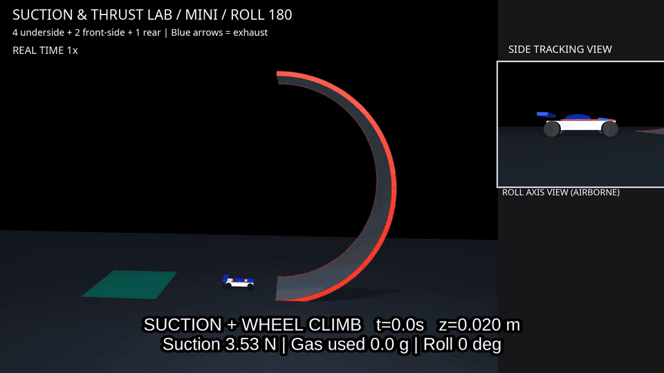
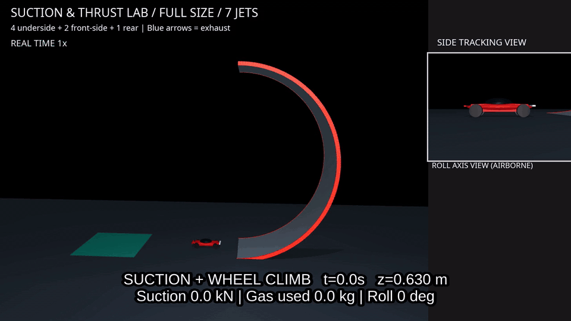

# Suction & Thrust Lab

[English](README.md) | 日本語

## プロジェクト概要

Suction & Thrust Labは、MuJoCoを使ってファンによる吸引、コールドガススラスタ、車両の運動を調べるオープンソースの物理シミュレーションプロジェクトです。公開時のリポジトリ名は`suction-thrust-lab`、Pythonパッケージ名は`suction_thrust_lab`です。

壁面走行、天井走行、ホバリング、空中姿勢制御などの特殊な運動を検証対象としています。すべての動作を実装済みという意味ではありません。主な検証例は小型車両で、実験用の実車サイズ設定も用意しています。今後は実車サイズのモデルを増やし、実測に基づく調整や機器の実現可能性の検討を進める予定です。

車体とコースは、単純な幾何形状を組み合わせて作成しています。メーカーのCADモデル、ロゴ、デカール、商品写真、発表映像は同梱していません。

## 機能と実装状況

| 機能 | 現在の状態 |
|---|---|
| 6自由度の剛体運動、接触、摩擦 | MuJoCoで実装 |
| 吸引力、圧力変化、空気漏れ、ファンの圧力–流量特性、バッテリー消費 | 集中定数の簡略モデルで実装 |
| 床・壁・天井とのシール判定 | 実装済み。平らな壁に働く力の向きはテスト済み |
| 天井への吸着とファン停止後の離脱 | 天井直下で反転した初期状態から実装 |
| コールドガス推力、中心から離れた位置の力によるトルク、ガス放出に伴う圧力低下、有限のガス残量 | 実装済み |
| 四輪駆動と吸引を使った曲面の登坂 | ハーフパイプ版で実装 |
| 180度ロール、空中での回復制御、低速での着地 | 設定した7基のスラスタ配置で実装 |
| 汎用的な壁面・天井走行、地上から飛行して天井へ吸着する動作 | 今後の予定 |
| 単独のホバリングデモ、汎用制御・推力配分、手動飛行 | 今後の予定。現在の飛行制御はシナリオ専用 |

## デモ

次のGIFには、収録した一連の動作と、その末尾に連結した0.25倍速の空中制御リプレイを含みます。青い矢印は排気の向きです。

### 小型版 49.8秒



### 実験用の実車サイズ版 98.4秒



実車サイズ版の機器や制御パラメータは実験用の仮定であり、量産車の仕様ではありません。[GIFの出所と再生成手順](docs/media/README.md)も参照してください。

### シナリオ一覧

| CLIのデモ名 | 内容 | 既定の計算時間 |
|---|---|---:|
| `downforce` | ファンのON/OFFによる床との接触荷重の変化を比較 | 3秒 |
| `ceiling` | 天井の下で保持し、ファン停止後に離脱 | 3秒 |
| `lift` | 0.3秒間の噴射で上昇し、その後落下 | 3秒 |
| `halfpipe` | 小型車両の駆動登坂、端からの離脱、180度ロール、回復、着地 | 24秒 |
| `full_size` | 別途仮定した機器を持つ実車サイズの車両で同じ動作を実行 | 40秒 |
| `tornado` | ミニ四駆サイズで5 m/sまで加速、浮上、前進しながら3秒間で14回転ロール、水平に戻ってすぐ走行着地 | 6秒 |
| `tornado_full_size` | 実車サイズで6台をごぼう抜き。3秒間で6回転し、着地後も先頭を走行 | 6秒 |

`tornado`は全長147 mmの車体と既存の7基のスラスタを使います。5 m/sはこのデモで設定した車輪の最高速度で、実製品の性能を表す値ではありません。浮上開始から約0.075秒で回転を始め、回転終了から約0.27秒で着地します。前後にホバリングする段階はありません。約3秒で14回転し、回転中は姿勢に合わせて底面スラスタを噴射し、飛行を続けます。先行する6台を回転中に追い抜き、着地後も最高速で走って先頭を保ちます。他車は3 m/sで走る演出用のマシンで、衝突判定から除外しています。CSVの`race_position`は順位、`overtaken`は車体全体が抜けた台数です。CSVの`touchdown_speed_m_s`は鉛直速度、`touchdown_forward_speed_m_s`は前進速度、`roll_total_deg`は累積ロール角です。設定は`tornado.py`の`demo_config()`にあり、`--config`のJSONに`tornado`オブジェクトを追加して変更できます。

`tornado_full_size`は全長4.536 m、乾燥重量1600 kgの既存実車モデルと7基のスラスタを使います。約216 km/hで走行中の状態から始まり、約108 km/hの先行車6台を回転中に追い抜きます。回転開始までの浮上は約0.15秒、回転終了から着地までは約0.30秒です。3秒間で6回転する制御に調整し、実車プロファイルの推力上限と有限のガス量を適用しています。設定は`tornado_full_size.py`の`tornado_full_size_config()`にあります。

両方の動画で、全スラスタから噴射したガスの累積消費量を表示します。小型版の単位はg、実車版はkgで、スロー再生でも同じ時点の累積値を表示します。

天井デモは、車体を反転させ、ファンがすでに回転している状態から始めます。初期の圧力差はゼロです。`--cold-fan`では、ファンの起動中にシールを失う例を確認できます。`lift`は短時間の噴射による浮上であり、ホバリング制御ではありません。

ハーフパイプ版は、底面4基、前方の側方2基、後方1基のスラスタを使います。上面のスラスタはありません。各推力を力・トルクへ変換する行列のランクは5で、側方の力とヨートルクは結び付いています。

元の解像度のMP4は`output/videos/suction-thrust-lab/`へ出力し、ソース配布・wheel配布から除外しています。動画のうちソース配布に含めるのは、`docs/media/`でバージョン管理するREADME用のGIF2本です。録画とGIFの再生成は次のコマンドで行えます。

```bash
MUJOCO_GL=egl python scripts/record_demos.py
MUJOCO_GL=egl python scripts/record_halfpipe.py --demo halfpipe
MUJOCO_GL=egl python scripts/record_halfpipe.py --demo full_size
MUJOCO_GL=egl python scripts/record_tornado.py
MUJOCO_GL=egl python scripts/record_tornado.py --demo tornado_full_size
python scripts/make_readme_gifs.py
```

ハーフパイプの動画には、全景、車体を追う側面の拡大図、飛行中のロール軸方向からの拡大図を表示します。末尾の0.25倍速リプレイは、端からの離脱から安定した着地までを対象としています。青い排気矢印の長さは表示用の尺度です。

録画には、`libx264`、`drawtext`、`subtitles`が使えるシステムの`ffmpeg`と、動作するEGL/OpenGL環境が必要です。FFmpeg本体とフォントは同梱していません。

## インストール

Ubuntu LinuxとPython 3.10以降を使用します。確認済みの環境はPython 3.14.4、MuJoCo 3.16.0、NumPy 2.5.4、pytest 9.1.1です。対応範囲のPythonと依存パッケージの組み合わせを、すべて検証したわけではありません。ViewerにはデスクトップセッションとOpenGLが必要ですが、画面表示なしの物理計算はディスプレイ不要です。

ソースを`suction-thrust-lab`というディレクトリ名で取得した後、次のコマンドを実行してください。

```bash
cd suction-thrust-lab
python3 -m venv .venv
source .venv/bin/activate
python -m pip install -e '.[test]'
```

`requirements.txt`には、検証時に使ったバージョンを記録しています。同じPythonバージョンで検証環境に合わせたい場合は、先にこれらをインストールしてください。

```bash
python -m pip install -r requirements.txt
python -m pip install --no-deps -e '.[test]'
```

固定した開発用バージョンは、古いPythonでは利用できない場合があります。通常の編集可能インストールでは、使用中のPythonに対応するバージョンを解決します。GitHubリポジトリを作成する前に、公開URLを仮定した案内は載せていません。

## クイックスタート

```bash
# MuJoCo Viewerで表示
suction-thrust-lab --demo ceiling
python -m suction_thrust_lab --demo halfpipe
python -m suction_thrust_lab --demo full_size

# 画面表示なしで物理計算し、CSVを記録
python -m suction_thrust_lab --demo ceiling --headless
python -m suction_thrust_lab --demo lift --headless
python -m suction_thrust_lab --demo halfpipe --headless
python -m suction_thrust_lab --demo full_size --headless
python -m suction_thrust_lab --demo tornado --headless
python -m suction_thrust_lab --demo tornado_full_size --headless
python -m pytest -q
```

Wayland上でGLFWを初期化できず、XWayland/X11が利用できる場合は次を試してください。

```bash
PYGLFW_LIBRARY_VARIANT=x11 python -m suction_thrust_lab --demo ceiling
```

Viewerの標準操作でカメラを動かせます。ウィンドウを閉じると実行を停止します。ハーフパイプの動作が未完了、または失敗した場合は、着地成功とせず失敗を報告します。

CLIは`output/<demo>.csv`へ記録します。`--csv`で保存先を指定でき、同名ファイルがある場合は上書きします。

## 物理モデル

| 内容 | 図入りサマリー・英語 | サマリー・日本語 | 詳細版・英語 |
|---|---|---|---|
| シミュレーションモデル | [力・シール・資源消費](docs/SIMULATION_DESIGN_SUMMARY.html) | [モデル設計](docs/SIMULATION_DESIGN_SUMMARY.ja.md) | [モデル設計と計算手順](docs/SIMULATION_DESIGN.md) |
| 制御 | [動作・フィードバック・推力制約](docs/CONTROL_SUMMARY.html) | [制御則](docs/CONTROL_SUMMARY.ja.md) | [制御則と推力配分](docs/CONTROL.md) |

英語サマリーは、それぞれ図とスタイルを埋め込んだ単独のHTMLです。ファイルをダウンロードしてブラウザで開けば、オフラインで表示できます。日本語サマリーはMarkdown内にMermaid図を記述しています。

単位の基準はSI単位系です。車体座標は前方が+x、左が+y、上方が+zです。ノズルの`direction`は車体に加わる力の向きで、排気はその逆向きになります。

吸引力の計算式は`F = delta_P * A`です。シールは面が近く、車体の向きが適切なときだけ有効になります。平面の確認点はスカートの四隅です。曲面では四隅と中央から、実際のコース形状へレイを飛ばします。曲面版では、有限の範囲でスカートが面に追従すると仮定しています。遠くの面へ引き付ける力は加えません。

```text
P_shutoff = P_max * n²
Q_fan = Q_max * n * max(0, 1 - delta_P / P_shutoff)
Q_leak = Cd * perimeter * gap * sqrt(2 * delta_P / rho)
d(delta_P)/dt = P_ambient / V * (Q_fan - Q_leak)
```

小さな圧力差と等温を仮定した近似モデルです。後退オイラー法と二分法で圧力を更新し、ファン回転数には応答遅れを設けています。消費電力は`n³`に比例し、有限のバッテリーからファンと車輪モータへ電力を供給する設定です。最大静圧と最大風量は同時に出せません。完全密閉・ファン停止のテストでは、ファンを逆流しないと仮定しています。通常の設定には残留漏れがあります。

コールドガスの基本式は`P = mRT/V`と`F = m_dot * v_e`です。タンク圧力が大気圧へ近づくと利用可能な推力が下がり、使えるガスがなくなると推力もゼロになります。各ノズルの消費要求は同じタンクから賄います。噴射位置に力を加える関数は`mj_applyFT`です。この力によって`r × F`のトルクも生じます。排気の運動エネルギーを積算して記録します。

車体の慣性モーメントは形状と質量から推定しています。基本デモでは質量と慣性を固定し、ハーフパイプ版ではガス消費に応じて更新する構成です。回転する独立した駆動輪を持つのもハーフパイプ版です。シナリオ専用の位置・姿勢PD制御で必要な力とトルクを求め、一方向の推力、圧力低下、出力上限の制約内で配分します。反転中は底面スラスタで重力を支えられないため落下し、正立後に減速します。

実験用の入力値と回帰検証の基準値は、[モデルの仮定と検証結果](docs/PHYSICS.md)を参照してください。CFD、実在気体、タンク冷却、詳しいノズル流れ、構造上の実現可能性、実測部品に合わせた調整は含みません。特に高圧ガスを使う実車サイズ版は、車両性能の予測ではなく理想化した条件の実験です。

## 設定

| ファイル | 用途 |
|---|---|
| `suction_thrust_lab/default.json` | 基本の小型車両による床・天井・浮上実験 |
| `suction_thrust_lab/halfpipe.json` | 小型車両と7基のスラスタによるロール動作 |
| `suction_thrust_lab/full_size.json` | 実験用の実車サイズ動作 |

```bash
mkdir -p configs
cp suction_thrust_lab/halfpipe.json configs/experiment.json
python -m suction_thrust_lab --demo halfpipe --config configs/experiment.json --headless --csv output/experiment.csv
```

ノズルの位置、力の向き、推力上限を設定ファイルに記述しています。ハーフパイプ版の推力配分は、文書化した7基の配置と順序に対応しており、任意の配置への変更には対応していません。基本車両の形状寸法は固定です。大きな車両には実車サイズ用の設定を使ってください。

見た目だけの形状は`model.py`や`full_size.py`から差し替えられます。外部アセットを含める場合は、事前に出所と利用許諾を確認・記録する必要があります。

CSVの記録項目は次のとおりです。

| 分類 | 記録内容 |
|---|---|
| 車両状態 | 時刻、位置、クォータニオン`w,x,y,z`、世界座標の並進速度、車体座標の角速度 |
| 吸引・電力 | 吸引力、圧力差、ファン・漏れ流量、消費電力、バッテリー残量 |
| 推進・接触 | スラスタごとの推力、ガス残量・圧力、排気エネルギー、接触荷重 |
| ハーフパイプ版の追加項目 | 段階名、変化する質量、ロール角、モータ消費エネルギー、推力配分のずれ、初回・最大の着地速度 |

力の値は直前の計算区間に対応し、位置・姿勢と接触の値は記録時刻で更新されています。接触荷重は接触法線力の大きさの合計であり、世界座標の鉛直力ではありません。

## ロードマップ

[ROADMAP.md](ROADMAP.md)では、現在の実装例と今後の作業を分けています。ファンとシールの実測、実在気体・熱のモデル、機器の質量と体積の見積もり、汎用的な制約付き制御、外乱への回復、壁面・天井走行、ホバリング操作、地上から天井へ連続して吸着する動作などが対象です。実測に合わせた実車サイズのモデルも追加する予定です。CFD、ROS 2、強化学習、Web UIは、現在の実装範囲に含めていません。

## 着想と参考資料

Tesla Roadsterのデモや、ファンによるダウンフォースとコールドガススラスタの構想に着想を得ています。180度ループや空中ロールを含む一部のシナリオは、Teslaの発表で示された動作を参考にしています。

物理モデル、制御器、プリミティブ形状の環境は、教育・実験を目的に本プロジェクト内で実装しました。調査した履歴とソースには、独自のPythonコードとMJCF生成処理があり、TeslaのコードやCADを取り込んだものではありません。これは実装の出所を判断する根拠であり、すべての第三者の権利について保証するものではありません。詳しくは[公開前レビュー](docs/PUBLICATION_REVIEW.md)を参照してください。

確認した公式資料は次のとおりです。

- [Tesla Roadsterの製品ページ](https://www.tesla.com/roadster)。製品・発表の公式情報で、仕様は変更される場合があります。
- [Tesla公式の1:18 Roadster模型](https://shop.tesla.com/en_ca/product/diecast-1_18-scale-roadster?sku=1524001-00-A)。公表された模型寸法は252 × 109.5 × 70 mmです。これを18倍し、モデル寸法4.536 × 1.971 × 1.260 mの参考にしました。模型からの推定であり、量産車の確定寸法ではありません。

参照したループ動作の公式動画URLは確認できていないため、推測したURLは載せていません。参考資料の映像や画像も同梱していません。

質量、圧力、タンク容量、排気速度、ファン特性、ノズルの数・配置・推力上限、モータ設定、制御ゲインは本プロジェクトの仮定です。公表値と似た数値でも、ここでは実験用の入力として扱い、Teslaの設計仕様とはみなしません。Teslaの独自設計や非公開の制御系を再現する実装ではありません。

## 免責・非公式であること

本プロジェクトは独立した非公式のオープンソースプロジェクトです。Tesla, Inc.、Tamiya, Inc.、および『爆走兄弟レッツ&ゴー!!』の制作者・出版社との提携、スポンサー契約、公式な推奨関係はありません。

「着想と参考資料」に載せた名称は、参照先を示すためのものです。車両とコースには汎用的なプリミティブ形状を使っています。非公式であるという表記によって、第三者の素材を使う許可が得られるわけではありません。利用許諾を確認できない素材は除外しています。シミュレーション結果だけで、実車がこれらの動作を安全に行えるとは判断できません。

## ライセンス

本プロジェクトの自作コード、設定、ドキュメント、README用に生成したGIFには、[MITライセンス](LICENSE)を適用しています。著作権表記は`Copyright (c) 2026 keg66`です。

依存ライブラリには、それぞれのライセンスが適用されます。[THIRD_PARTY_NOTICES.md](THIRD_PARTY_NOTICES.md)に依存関係の調査結果と、バイナリ同梱時の注意点を記載しています。ソース配布に同梱するメディアは、README用のGIF2本です。実行用wheelにはメディアや依存ライブラリのバイナリを含めません。公開前に人間の確認が必要な項目は、[公開前レビュー](docs/PUBLICATION_REVIEW.md)にまとめています。
