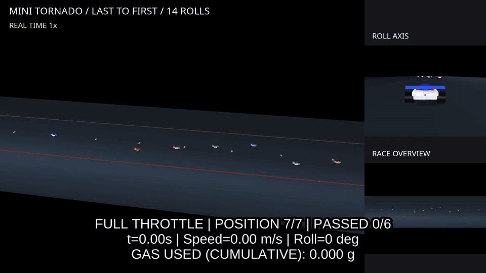
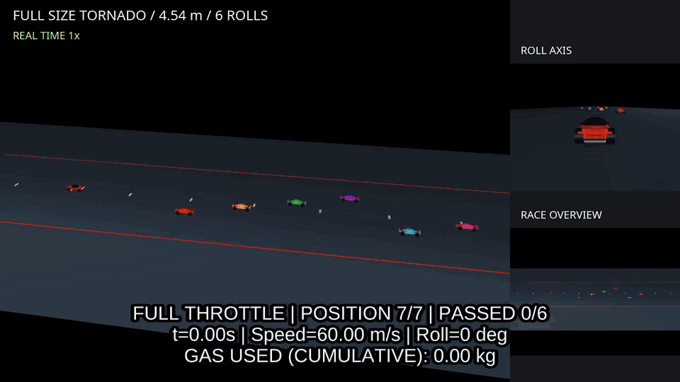

# Suction & Thrust Lab

English | [日本語](README.ja.md)

## Project Overview

Suction & Thrust Lab is an open-source physics simulation project exploring fan-generated suction, cold-gas thrusters, and vehicle dynamics using MuJoCo. The intended repository name is **`suction-thrust-lab`**; the Python package is **`suction_thrust_lab`**.

It investigates unconventional vehicle maneuvers, including wall climbing, ceiling driving, hovering, and aerial attitude control. These are research directions, not a claim that every maneuver is implemented. A miniature vehicle is the primary example. An experimental full-size preset already exists; further full-size vehicle models, calibration, and hardware feasibility studies are planned.

All vehicle and course geometry is built from simple primitives. No manufacturer CAD models, logos, decals, product photographs, or presentation footage are distributed.

## Features

| Capability | Current status |
|---|---|
| 6DoF rigid-body dynamics, contact and friction | Implemented in MuJoCo |
| Suction, pressure dynamics, leakage, fan P–Q curve and battery consumption | Implemented as simplified lumped models |
| Floor, wall and ceiling seal eligibility | Implemented; flat-wall force direction is tested |
| Ceiling attachment and fan-off release | Implemented from an inverted, near-ceiling initial state |
| Cold-gas thrust, off-center torque, blow-down and finite gas supply | Implemented |
| Four driven wheels and suction-assisted curved climbing | Implemented in the half-pipe examples |
| Roll-180, controlled aerial recovery and soft landing | Implemented for the configured seven-nozzle layouts |
| Generic wall/ceiling driving, floor-to-ceiling flight and attachment | Planned |
| Standalone hover demo, general controller/allocation, manual flight controls | Planned; current flight control is scenario-specific |

## Demonstrations

These previews include the complete recorded sequence and the appended, labelled **0.25× air-control replay**. Blue arrows show exhaust direction.

### Miniature vehicle · 49.8 seconds


### Experimental full-size vehicle · 98.4 seconds


### Tornado overtaking · miniature · 21.0 seconds

Fourteen rolls over three seconds, overtaking all six rivals and landing in the lead. Cumulative gas use is shown in grams.



### Tornado overtaking · full-size · 21.4 seconds

Six rolls over three seconds at about 216 km/h, overtaking all six rivals. Cumulative gas use is shown in kilograms.



The full-size hardware and control parameters are experimental assumptions, not production-vehicle specifications. See [preview provenance and regeneration](docs/media/README.md).

### Scenarios

| CLI demo | What it does | Default duration |
|---|---|---:|
| `downforce` | Compare floor contact load with the fan off/on | 3 s |
| `ceiling` | Hold beneath a ceiling, then release when the fan stops | 3 s |
| `lift` | Rise under a 0.3 s thrust pulse, then fall | 3 s |
| `halfpipe` | Miniature vehicle: driven climb, edge departure, roll-180, recovery and landing | 24 s |
| `full_size` | The same sequence with an experimental full-size vehicle and separately assumed hardware | 40 s |
| `tornado` | Miniature: accelerate to 5 m/s, lift, 14 forward-moving rolls over 3 seconds and immediate rolling touchdown | 6 s |
| `tornado_full_size` | Full-size rolling race start, six overtakes, six rolls in 3 s and immediate rolling touchdown in the lead | 6 s |

`tornado` uses the 147 mm chassis and existing seven jets. Its configured wheel top speed of 5 m/s is a demo assumption, not a real product specification. Roll begins about 0.075 s after lift starts, and touchdown follows about 0.27 s after the last turn, without a hover stage. It performs 14 rolls in about 3 s, uses timed underside thrust during rotation to sustain flight, overtakes six pace cars during the roll, then keeps driving at top speed after touchdown to hold the lead. Rivals follow scripted 3 m/s motion and are excluded from collisions. CSV `race_position` reports rank and `overtaken` counts fully cleared cars. CSV `touchdown_speed_m_s` measures vertical speed; `touchdown_forward_speed_m_s` records forward speed and `roll_total_deg` records cumulative roll. Defaults live in `tornado.py` (`demo_config()`); a `tornado` object in a `--config` JSON overrides them.

`tornado_full_size` uses the existing 4.536 m, 1600 kg dry-mass full-size chassis and seven jets. It begins already driving at 60 m/s (216 km/h), overtakes six 30 m/s pace cars during a three-second, six-turn roll, and keeps the lead after touchdown. Lift entry takes about 0.15 s and touchdown follows the last turn by about 0.30 s. The existing experimental full-size thrust limits and finite gas supply remain in effect. Defaults live in `tornado_full_size.py` (`tornado_full_size_config()`).

Both tornado videos show cumulative gas expelled by all thrusters: grams for the miniature and kilograms for the full-size version. Slow replay preserves the cumulative value at each physical instant.

The ceiling example begins inverted with the fan already spinning and zero initial pressure difference. `--cold-fan` demonstrates failure to seal during startup. The lift pulse is not a hover controller. Half-pipe flight uses four underside jets, two front lateral jets and one rear jet. There are no top-mounted jets in those examples. Their instantaneous wrench matrix has rank five; lateral force and yaw torque are coupled.

Full-resolution MP4 recordings are generated locally under `output/videos/suction-thrust-lab/` and are excluded from source/wheel distributions. The four README GIF previews are versioned under `docs/media/` and included in the source distribution. To regenerate the recordings:

```bash
MUJOCO_GL=egl python scripts/record_demos.py
MUJOCO_GL=egl python scripts/record_halfpipe.py --demo halfpipe
MUJOCO_GL=egl python scripts/record_halfpipe.py --demo full_size
MUJOCO_GL=egl python scripts/record_tornado.py
MUJOCO_GL=egl python scripts/record_tornado.py --demo tornado_full_size
python scripts/make_readme_gifs.py
```

The half-pipe recordings show an overview, a side tracking view, and an axial view during flight. Each combined movie appends a 0.25× replay from edge departure through stable landing. Blue arrows show exhaust direction with a display-only length scale. Recording needs a separate system `ffmpeg` executable with `libx264`, `drawtext`, and `subtitles`, plus a working EGL/OpenGL environment. Neither FFmpeg nor fonts are redistributed here.

## Installation

Use Ubuntu Linux and Python 3.10 or newer. The checked environment is Python 3.14.4, MuJoCo 3.16.0, NumPy 2.5.4 and pytest 9.1.1; other supported Python/dependency combinations have not all been tested. Viewer use requires a desktop session and OpenGL. Headless physics does not require a display.

After obtaining this source in a directory named `suction-thrust-lab`:

```bash
cd suction-thrust-lab
python3 -m venv .venv
source .venv/bin/activate
python -m pip install -e '.[test]'
```

`requirements.txt` records the exact versions used for verification. On the same Python version, install those first if you need that environment:

```bash
python -m pip install -r requirements.txt
python -m pip install --no-deps -e '.[test]'
```

The development pins may not be available for every older Python version; the ordinary editable install resolves versions compatible with your interpreter. No GitHub repository URL is assumed before the repository is created.

## Quick Start

```bash
# Interactive MuJoCo Viewer
suction-thrust-lab --demo ceiling
python -m suction_thrust_lab --demo halfpipe
python -m suction_thrust_lab --demo full_size

# Display-free physics and CSV logging
python -m suction_thrust_lab --demo ceiling --headless
python -m suction_thrust_lab --demo lift --headless
python -m suction_thrust_lab --demo halfpipe --headless
python -m suction_thrust_lab --demo full_size --headless
python -m suction_thrust_lab --demo tornado --headless
python -m suction_thrust_lab --demo tornado_full_size --headless
python -m pytest -q
```

If a Wayland session cannot initialize GLFW and XWayland/X11 is available:

```bash
PYGLFW_LIBRARY_VARIANT=x11 python -m suction_thrust_lab --demo ceiling
```

The Viewer supports its standard camera controls. Closing the window stops the run. An incomplete or failed half-pipe sequence reports failure rather than claiming a verified landing. CLI runs write `output/<demo>.csv`; `--csv` selects another path and existing output files are overwritten.

## Physics Models

| Topic | Visual summary (EN) | サマリー（日本語） | Detailed reference |
|---|---|---|---|
| Simulation model | [Forces, seals and resources](docs/SIMULATION_DESIGN_SUMMARY.html) | [モデル設計](docs/SIMULATION_DESIGN_SUMMARY.ja.md) | [Model design and integration](docs/SIMULATION_DESIGN.md) |
| Control | [Maneuver, feedback and jet limits](docs/CONTROL_SUMMARY.html) | [制御則](docs/CONTROL_SUMMARY.ja.md) | [Control laws and allocation](docs/CONTROL.md) |

The English summaries are standalone HTML: download either file and open it in a browser to view all figures offline. The Japanese summaries use Mermaid diagrams within their Markdown files.

All physical inputs use SI units. Body axes are +x forward, +y left and +z up. A nozzle's `direction` is the force on the vehicle; exhaust travels in the opposite direction.

**Suction:** `F = delta_P * A`. A seal is valid only for nearby, correctly oriented surfaces. Flat-surface checks use the skirt corners. Curved examples ray-test the corners and center against the actual course geometry, with a finite flexible-skirt travel assumption. Remote surfaces do not attract the vehicle.

```text
P_shutoff = P_max * n²
Q_fan = Q_max * n * max(0, 1 - delta_P / P_shutoff)
Q_leak = Cd * perimeter * gap * sqrt(2 * delta_P / rho)
d(delta_P)/dt = P_ambient / V * (Q_fan - Q_leak)
```

This is a low-pressure-difference, isothermal approximation, integrated by backward Euler and bisection. Fan speed has a response lag, electrical input scales as `n³`, and a finite battery also supplies the wheel motors. Maximum static pressure and free-air flow are not simultaneously available. A completely sealed, stopped-fan test assumes no reverse flow; normal examples retain leakage.

**Cold gas:** `P = mRT/V`, `F = m_dot * v_e`. Available thrust decreases with tank pressure above ambient. Mass demand is shared across the nozzles, and thrust vanishes when usable gas is exhausted. Force is applied at each nozzle location with `mj_applyFT`, producing `r × F` torque. Exhaust kinetic energy is accumulated.

**Vehicle and control:** inertia is estimated from vehicle dimensions. The basic demos keep mass/inertia fixed, while half-pipe examples update them as gas is consumed. Wheels are separate driven joints only in the half-pipe examples. Scenario-specific position/attitude PD control requests a wrench subject to one-way jets, pressure loss and saturation. Inverted underside jets cannot support gravity: the car falls during the roll and brakes after becoming upright.

See [model assumptions and reference results](docs/PHYSICS.md) for experimental inputs and regression checks. These models omit CFD, real-gas behavior, tank cooling, detailed nozzle flow, structural feasibility, and measured component calibration. In particular, the high-pressure full-size preset is an idealized experiment, not a vehicle performance prediction.

## Configuration

| File | Use |
|---|---|
| `suction_thrust_lab/default.json` | Basic miniature floor/ceiling/lift experiments |
| `suction_thrust_lab/halfpipe.json` | Miniature seven-jet roll sequence |
| `suction_thrust_lab/full_size.json` | Experimental full-size sequence |

```bash
mkdir -p configs
cp suction_thrust_lab/halfpipe.json configs/experiment.json
python -m suction_thrust_lab --demo halfpipe --config configs/experiment.json --headless --csv output/experiment.csv
```

Nozzle positions, force directions and limits are explicit. The half-pipe allocator supports the documented seven-nozzle layout/order, not arbitrary replacements. Basic vehicle geometry has fixed dimensions; use the dedicated full-size profile for the larger model. Visual-only geometry can be replaced through `model.py`/`full_size.py`, but external assets require a documented source and permission before inclusion.

CSV data includes time, position, quaternion (w,x,y,z), world linear velocity, body angular velocity, suction force/pressure, fan/leak flow, power/battery energy, per-nozzle thrust, gas mass/pressure, exhaust energy and contact load. Half-pipe logs add stage, changing mass, roll angle, motor energy, allocation residual and first/maximum touchdown speed. Forces describe the preceding integration interval; pose/contact values are refreshed at the row's time. Contact load is the sum of contact-normal magnitudes, not a world-z force.

## Roadmap

[ROADMAP.md](ROADMAP.md) separates current examples from planned work: measured fan/seal data, real-gas and thermal tank models, hardware mass/volume budgets, general constrained control, disturbance rejection, wall/ceiling driving, hover controls, and continuous floor-to-ceiling attachment. Additional calibrated full-size models are planned. CFD, ROS 2, reinforcement learning and a web UI are outside the current scope.

## Inspiration

This project was inspired by Tesla's Roadster demonstrations and its proposed use of fan-generated downforce and cold-gas thrusters. Some scenarios, including the 180-degree loop and aerial roll, take inspiration from maneuvers shown in Tesla's presentations.

The simulation models, controllers and primitive environments were implemented within this project for educational and experimental use. The reviewed history and source contain local Python/MJCF-generating implementations, not imported Tesla code or CAD. This is evidence of the implementation's provenance, not a guarantee about every possible third-party right; see [the publication review](docs/PUBLICATION_REVIEW.md).

Verified official references:

- [Tesla Roadster product page](https://www.tesla.com/roadster): official product/presentation context; specifications may change.
- [Tesla's official 1:18 Roadster model](https://shop.tesla.com/en_ca/product/diecast-1_18-scale-roadster?sku=1524001-00-A): published model dimensions are 252 × 109.5 × 70 mm. Multiplying by 18 informed the example's 4.536 × 1.971 × 1.260 m dimensions. This is an inference from a scale model, not a confirmed production-car dimension set.

The exact official video URL for the supplied loop sequence has not been verified, so no guessed video URL is listed. No footage or images from those references are included.

Mass, pressure, tank volume, exhaust velocity, fan performance, nozzle count/placement/limits, motor parameters and control gains are project assumptions. Even a value that resembles a public claim is treated here as an experimental input, not as Tesla's engineering specification. The implementation does not reproduce Tesla's proprietary designs or undisclosed control system.

## Disclaimer

This is an independent, unofficial open-source project. It is not affiliated with, sponsored by, or endorsed by Tesla, Inc., Tamiya, Inc., or the creators and publishers of Bakusou Kyoudai Let's & Go!!.

Names in the Inspiration section identify external references only. The vehicles and courses in this repository are generic primitive models. Non-affiliation does not grant permission to use third-party material; assets with unverified permissions are excluded. Simulation results do not establish that a real vehicle can safely perform these maneuvers.

## License

The project's own code, configurations, documentation and generated README previews are licensed under the [MIT License](LICENSE). Copyright (c) 2026 keg66.

Dependencies retain their own licenses. [THIRD_PARTY_NOTICES.md](THIRD_PARTY_NOTICES.md) records the reviewed dependencies and binary-bundling caveats. Source distributions include the four README GIF previews. Runtime wheels exclude media, and neither source nor wheel distributions bundle dependency binaries. [Publication review](docs/PUBLICATION_REVIEW.md) lists remaining human checks.
