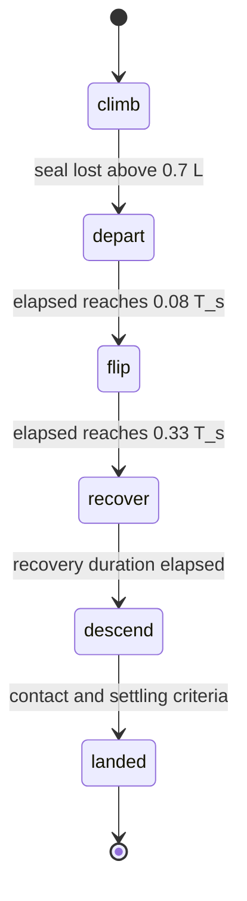

# Control laws and flight sequence (detailed)

For a diagram-led introduction, read the [summary](CONTROL_SUMMARY.html) first. A [Japanese Markdown summary](CONTROL_SUMMARY.ja.md) is also available.

This is a description of [`FlightController`](../suction_thrust_lab/halfpipe.py) and `HalfpipeSimulation.advance()` as implemented. It is a scenario-specific PD controller with feed-forward terms and an analytical, constrained nozzle allocator. It is not an integral PID, a generic six-axis autopilot, or a globally stable flight-control design. The controller reads exact simulation state; sensor noise, estimation and transport delays are not modeled.

Read [Simulation model design](SIMULATION_DESIGN.md) for force application, seals, mass and resource integration. [Physics assumptions](PHYSICS.md) lists the current experimental inputs and reference results.

## Frames, scales and update rates

`R` maps body coordinates into world coordinates. Its columns are the body axes in the world frame. Body +x is forward, +y left, +z up; the world +z axis is vertical. A requested wrench is expressed in the **current body frame** and ordered as:

```text
w = [Fx, Fy, Fz, torque_x, torque_y, torque_z]
```

The controller uses length scale `L`, time scale `T_s` and motor torque scale `Q_s`. To avoid confusing the time scale with tank temperature, this document writes `T_s` where the code uses `self.T`.

```text
position_normalized = position_world / L
velocity_normalized = velocity_world * T_s / L
elapsed_normalized  = (time - flight_start) / T_s
omega_normalized    = omega_body * T_s
```

| Quantity | Miniature half-pipe | Full-size preset |
|---|---:|---:|
| `L` | 1 | 30.85714 |
| `T_s` | 1 | 5.55492 |
| `Q_s` | 1 | 411428.57 |
| Nominal flight-command interval | 2 ms | 10 ms |
| Position response time | 1 s (default) | 3 s |
| Attitude response time | 1 s (default) | 4 s |
| Recovery / descent durations | 2.8 / 3 s | 6 / 5 s |
| Acceleration feed-forward | Disabled | Enabled |

During flight, nozzle commands are recalculated no more often than `min(0.002 * T_s, 0.01)` seconds and held between updates. Physics, gas consumption and wheel control run at the 1 ms physics step. Stage transitions governed by flight feedback may therefore occur one command interval after their threshold. Climbing and the landed stop are handled before that rate limiter.

`force_scale` is the profile's **initial total mass** divided by the miniature reference total mass, 0.16597335476304644 kg. It is a fixed normalization factor; gravity compensation uses the changing `total_mass` instead.

## Sequence and wheel-driven climb



Failure text is tracked separately from these stages. A sequence can reach `landed` and still be rejected because an earlier contact or resource check failed.

| Stage | Fan / drive / thrust action |
|---|---|
| `climb` | Fan command 1, wheel speed tracking, no commanded gas thrust |
| `depart` | Fan command 0, rear-jet clearance request and launch-attitude hold |
| `flip` | Roll-180 reference, differential bottom-jet torque and late vertical braking |
| `recover` | Position/velocity feedback, tilt-based translation and attitude stabilization |
| `descend` | Smooth descending reference, position/attitude feedback and landing checks |
| `landed` | Fan and nozzle commands zero; wheel speed reference zero |

During climbing the physical wheel-speed reference is:

```text
v_drive = ramp.drive_speed * min(1, time / (0.5 * T_s))
omega_wheel_reference = v_drive / (0.013 * L)
torque_wheel = clip(0.003 * Q_s * T_s * (omega_reference - omega_wheel),
                    -0.012 * Q_s, +0.012 * Q_s)
```

Each wheel has its own feedback torque. MuJoCo contact/friction converts wheel rotation into traction. The fan increases contact loading; no artificial tangent force pulls the body up the ramp. Ordinary powered drive commands are zeroed when the shared battery is empty. In airborne stages they are overridden by a small wheel-spin braking torque, clipped to `±0.001 * Q_s` (see the electrical approximation in [model design](SIMULATION_DESIGN.md)).

The controller leaves `climb` when the normalized height exceeds 0.7 and the actual five-point seal test fails. It records the current physical launch position, orientation and time. This is an edge event, not a scheduled teleport or a prescribed climb trajectory. If a modified system never reaches that condition, the controller remains in `climb`; the CLI ultimately rejects an incomplete sequence.

## Departure and roll-180 reference

Let `e = (t - flight_start) / T_s`. For `e < 0.08`, the requested body force is `(0.4 * force_scale, 0, 0)`. The rear jet accelerates the vehicle along its current forward direction to clear the lip. The attitude controller holds the recorded launch orientation. Roll/pitch correction can also require bottom-jet thrust even though the requested common lift is zero.

For `0.08 <= e < 0.33`, define:

```text
u       = clip((e - 0.08) / 0.25, 0, 1)
phi     = pi * (3u² - 2u³)
phi_dot = pi * 6u(1-u) / 0.25
phi_ddot = pi * (6 - 12u) / 0.25²
R_desired = R_launch * Rx(phi)
```

The derivatives are with respect to normalized time. Right-multiplication by `Rx` rotates around the launch vehicle's longitudinal x axis: a **roll**, rather than a nose-over-tail pitch. The desired forward axis stays equal to the launch forward axis. Angular-rate and angular-acceleration references are mapped from the desired frame to the current body frame with `R.T @ R_desired` before attitude control.

The 180-degree reference takes `0.25 * T_s` physical seconds. The cubic angle starts and ends with zero angular rate, but its acceleration is nonzero at those endpoints; the complete reference is not globally acceleration-continuous. Tracking is limited by available one-way nozzle forces.

There are no top jets. When the vehicle is inverted, its bottom jets point their vehicle force downward in world coordinates. An asymmetric bottom-jet command creates roll torque, but also a downward force. It cannot independently cancel gravity. Thus the vehicle loses altitude during inversion; the controller does not hide that loss.

The requested common lift is zero until `R[2,2] > 0.96`. Once almost upright, the controller requests:

```text
Fz_body = clip(m_total * (g - 14 * velocity_normalized_z * L / T_s²)
               / R[2,2], 0, 9 * force_scale)
```

This is a late vertical-velocity braking heuristic. Its request is still subject to allocation and tank-pressure limits. A zero common-lift request does not imply all bottom jets are off: producing torque can require a positive common bias.

## Recovery and descent reference generation

On entering `recover`, the controller saves the current normalized position as `recovery_origin` and chooses `recovery_height = max(0.30, current_normalized_z)`.

Reference interpolation uses the quintic blend and derivatives:

```text
b(u)   = 10u³ - 15u⁴ + 6u⁵
b'(u)  = 30u² - 60u³ + 30u⁴
b''(u) = 60u - 180u² + 120u³
```

For recovery, `u` runs from 0 to 1 over the configured recovery duration. The horizontal reference moves from `recovery_origin` to normalized `(-0.65, 0)`. The vertical reference is immediately set to `recovery_height`, with zero vertical reference velocity/acceleration. Consequently, recovery is **not** a smooth blend on all three axes: if the vehicle is below `0.30 * L`, the height target steps upward while the actual body position remains continuous.

For descent, the horizontal target stays `(-0.65, 0)` and the normalized vertical reference blends from `recovery_height` to 0.0195 over the configured descent duration. The physical target is the normalized target multiplied by `L`. The final height reference sits slightly below the nominal resting center height, letting the tires make contact with the floor. Contact dynamics determine the actual resting pose.

Recovery can transition to descent based on time without a separate position-error convergence requirement. Resource exhaustion and bad touchdown can therefore fail a modified case; a smooth reference alone does not guarantee successful tracking.

## Position feedback and conversion to tilt

Define normalized position/velocity errors `ep = target - position_normalized` and `ev = target_velocity - velocity_normalized`, and `k = T_s / position_response_time`. The normalized acceleration request is:

```text
ax = 12 k² ep_x +  7 k ev_x
ay = 12 k² ep_y +  7 k ev_y
az = 22 k² ep_z + 10 k ev_z
```

The reference acceleration is added only when `flight.acceleration_feedforward` is enabled. Physical acceleration is then `a = a_normalized * L / T_s²`. The horizontal vector is norm-limited by `horizontal_acceleration_limit` (no limit in the miniature preset; 4 m/s² in the full-size preset).

The desired world force, including gravity compensation, is:

```text
F_world = m_total * (a + [0, 0, g])
F_world_z = max(0.15 * force_scale, F_world_z)
```

The desired body +z axis is `z_d = F_world / norm(F_world)`. With a nominal heading vector `h = (-1, 0, 0)`:

```text
y_d = normalize(z_d × h)
x_d = y_d × z_d
R_desired = [x_d, y_d, z_d]
```

This holds a backward-facing course heading while tilting the bottom jets toward the required force. It does not independently assign three translational forces plus three torques. The requested body wrench is:

```text
w = [0, 0, max(0, dot(F_world, R[:,2])), attitude_torque]
```

Horizontal acceleration mainly comes from tilting the four bottom jets. Side jets are used by the allocator for yaw and necessarily add lateral force. During attitude transients, the projected force and the desired world force need not match; saturation can increase that mismatch. There is no integral term, anti-windup system, explicit attitude envelope or collision-avoidance planner.

## Attitude feedback and feed-forward

`attitude_torque()` constructs the relative rotation `R.T @ R_desired`, converts it to a quaternion and chooses the sign with nonnegative scalar part. The resulting shortest-angle axis vector is:

```text
theta = 2 atan2(norm(q_xyz), max(0, q_w))
e_R   = q_xyz * theta / max(norm(q_xyz), 1e-12)
```

Let `tau_R` be `attitude_response_time`, `omega_n = T_s * omega_body`, and `rate_n` / `accel_n` the optional normalized-time reference rate/acceleration. The exact implemented law is:

```text
alpha = (450 / tau_R²) * e_R
      + (36 / (tau_R * T_s)) * (rate_n - omega_n)
      + accel_n / T_s²

torque = I_chassis * alpha
       + cross(omega_n, I_chassis * omega_n) / T_s²
```

`I_chassis` is a three-element diagonal inertia and multiplication is componentwise. Rate and acceleration references default to zero outside the planned roll. With zero references, this is proportional orientation feedback plus angular-rate damping and an approximate gyroscopic compensation term. The controller uses the chassis inertia, not the exact inertia of the complete articulated vehicle/wheel system. It also assumes direct state access and ignores the reference body's moving-frame derivative terms beyond those explicitly shown.

The shortest-rotation representation is ambiguous at exactly 180 degrees. The programmed roll follows incremental reference orientations, but this does not establish global attitude convergence from arbitrary initial states.

## Seven-nozzle allocation and control authority

For each unit body-force direction `d_i` and nozzle position `r_i`, the allocation matrix column is `[d_i; r_i × d_i]`. Thus `A f` is the body wrench produced by nozzle force magnitudes `f`.

The allocator checks the supplied layout/order against the miniature reference wrench matrix, with positions scaled by vehicle dimensions. Its equations assume the following ordering and symmetric bottom-jet geometry:

| Indices | Nozzles | Vehicle-force direction / purpose |
|---|---|---|
| 0–3 | `lift_fl`, `lift_fr`, `lift_rl`, `lift_rr` | Body +z; common lift and differential roll/pitch |
| 4 | `side_left` | At front left, force toward body −y |
| 5 | `side_right` | At front right, force toward body +y |
| 6 | `boost` | At rear, force toward body +x |

Both front lateral jets have longitudinal coordinate `a > 0` and zero vertical coordinate. Their forces satisfy `torque_z = a * Fy`. There is no separate lateral force actuator that cancels that coupling. `A` has rank **five**, and the nonnegative-force constraint further restricts the feasible wrench set. Rank five does not prohibit a planned maneuver over time, but it does prohibit treating instantaneous six-axis requests as independently achievable.

For the bottom jets, with symmetric positions `(x_i, y_i)`, the initial allocation is:

```text
f_i_raw = max(0,Fz)/4 + torque_x * y_i / sum(y_j²)
                       - torque_y * x_i / sum(x_j²)
bias    = max(0, -min(f_0_raw, ..., f_3_raw))
f_i_desired = f_i_raw + bias
```

Without saturation, adding the common bias leaves the differential roll/pitch torque unchanged and increases the total body +z force by `4 * bias`. This favors realizing attitude torque at the expense of the common-lift request. For example, a pure roll request cannot be made with negative thrust on the other side: the allocator fires one side more strongly and produces additional net force. Independent clipping at the nozzle limits can subsequently spoil both torque and force; this is not a quadratic-programming optimizer with a strict priority guarantee.

For the remaining jets:

```text
Fy_for_yaw = torque_z / a
f_4_desired = abs(Fy_for_yaw) if Fy_for_yaw < 0 else 0
f_5_desired = abs(Fy_for_yaw) if Fy_for_yaw >= 0 else 0
f_6_desired = max(0, Fx)
```

The requested `Fy` is not independently allocated. The allocator computes pressure-dependent limits `f_i_limit = f_i,max * pressure_ratio`, clips each desired magnitude to that limit and divides by the limit to obtain normalized valve commands. Zero limits produce zero commands. `GasTank.step()` then applies actual blow-down and usable-gas limits at each physics step.

`allocation_error = norm(A @ f_clipped - w_requested)` is calculated at allocation time. It combines newtons and newton-metres without normalization, so it has no single physical unit and should not be compared across vehicle scales as a calibrated error metric. It is a predicted wrench mismatch, not a continuously recomputed measurement of post-step actual thrust; held commands and pressure loss can alter the force afterward.

## Landing, failure and what success means

`HalfpipeSimulation.advance()` detects new floor-contact events after each physics step. Touchdown speed is the **norm of world linear velocity before that step**, including horizontal motion; it is not just vertical impact speed. The first event sets `touchdown_speed_m_s`; repeated events update `max_touchdown_speed_m_s`.

The current checks report failure when:

- A new floor contact occurs outside `descend`/`landed` after climbing.
- A new touchdown exceeds the profile's speed limit (0.15 m/s miniature, 0.5 m/s full-size).
- Usable gas is exhausted during an airborne stage.
- Flight exceeds its physical-time timeout before a stable landing (8 s miniature, 20 s full-size).

Inside descent, `landed` requires a recorded first touchdown, a current floor contact, more than `0.15 * T_s` since that first touchdown, `R[2,2] > 0.99`, and world linear speed below the settling threshold (default `0.06 * L / T_s`, explicitly 0.1 m/s for full-size). This is not a requirement for uninterrupted contact over that interval, and it does not directly bound angular velocity. The sequence tests apply additional final-velocity checks.

A failure flag does not stop the integrator immediately; the CLI rejects completion if there is a failure or the final stage is not `landed`. Contacts are not disabled during the roll, nor is gas exhaustion bypassed to finish the sequence.

## Where parameters live

| Setting | Location and effect |
|---|---|
| Nozzle positions/directions/limits | Profile `thrusters`; allocator geometry/order restrictions still apply |
| Fan, seal, tank and battery | Profile `suction` / `gas`; these affect available force and endurance rather than feedback gains |
| Climb speed and skirt travel | Profile `ramp`; drive speed is physical m/s |
| Response times and flight durations | Optional profile `flight`; durations/response times are physical seconds before controller normalization |
| Full-size scaling | Profile `scaling`; length, time and motor torque scales are separate values |
| PD coefficient multipliers | Python constants in `attitude_torque()` / `control()`: 450/36, 12/7 and 22/10 |
| Departure/roll timing and normalized landing location | Python constants in `control()`, not arbitrary JSON waypoints |

Reducing response times increases effective feedback gains; it does not increase valve authority or tank pressure. Increasing bottom thrust may improve torque response while also increasing the unwanted force created by roll allocation. Resource and contact logs are therefore necessary when evaluating tuning changes.

## Basic demos and remaining scope

The basic demos in [`simulation.controls()`](../suction_thrust_lab/simulation.py) use time-scheduled commands: fan on/off for downforce/ceiling and an equal four-jet lift pulse for `lift`. They have no altitude feedback. A constant valve command initially balancing weight loses force as tank pressure falls; it is not sustained hovering.

The present half-pipe controller demonstrates one constrained launch/roll/recovery/landing sequence. Generic hover tracking, disturbed arbitrary initial conditions, general nozzle layouts, manual flight, wall/ceiling driving and flight-to-ceiling capture require further control design and validation. Changing a gain or a thrust limit should be evaluated with the existing [sequence tests](../tests/test_halfpipe.py), [full-size tests](../tests/test_full_size.py), contact/resource logs and allocation residuals, rather than appearance alone.
