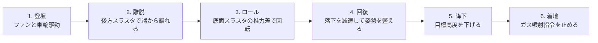
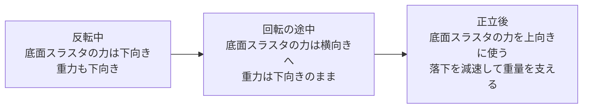
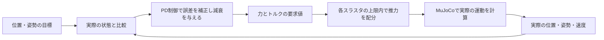
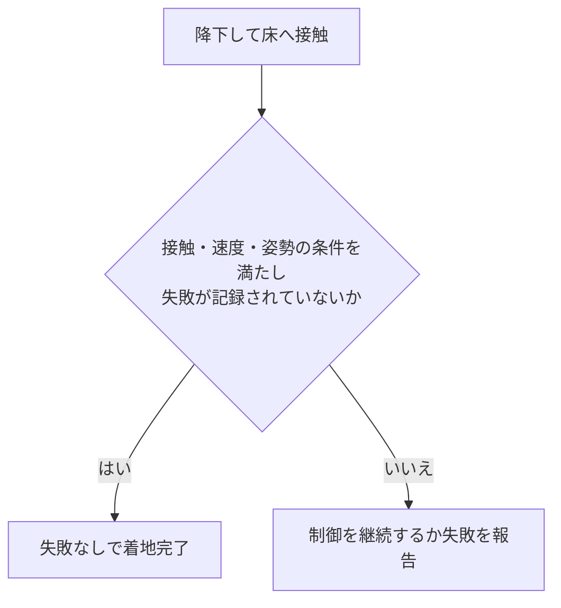

# 制御則 サマリー

ハーフパイプの制御器は、登坂・離脱・ロール・着地を段階的に実行します。目標との差から必要な力とトルクを求め、実際に配置したスラスタへ配分する構成です。

[英語のサマリー](CONTROL_SUMMARY.html)に対応した日本語版です。式やタイミング、スケール換算、成功判定の詳細は、英語の[制御則 詳細版](CONTROL.md)で説明しています。図も含めた1つのMarkdownファイルです。

## 1. 一連の動作を6段階に分ける

車体が一定の高さを超え、実際のシール判定で面を失ったときに離脱を始めます。その後は経過時間と接触・車両状態を確認しながら段階を進めます。離脱時の位置と姿勢は目標生成の基準として保存し、次の段階へ車体を瞬間移動させることはありません。

この制御器を使うのは、連続動作するハーフパイプ版です。基本デモの`ceiling`、`downforce`、`lift`では、時刻に応じてファンや推力を切り替えます。

## 2. ロール中に高度が下がる理由

半回転する軸は、車体の前後を結ぶロール軸です。離脱時の前方向を保ちながら、左右を回転させます。車体上部のスラスタはありません。反転中は底面スラスタの力が世界座標で下向きになるため、重力を支えられません。

片側を強く噴射するとロールトルクが生じますが、並進方向の力も加わります。回転トルクだけを独立して出すことはできません。制御器は反転中の高度低下を許容し、ほぼ正立したところから上向きの力で落下を減速します。

回復には、十分な高度、ガス残量、推力、姿勢を制御する能力が必要です。図は力の向きを説明する模式図であり、実測形状や実際の軌跡を描いたものではありません。

スラスタの配置と、車体に加える力の向きは次のとおりです。車体座標は前方が+x、左が+y、上方が+zです。

| 配置 | 基数 | 車体に加わる力の向き |
|---|---:|---|
| 底面の四隅 | 4 | 車体の上向き、+z |
| 前方の左側 | 1 | 車体の右向き、−y |
| 前方の右側 | 1 | 車体の左向き、+y |
| 後方 | 1 | 車体の前向き、+x |

これらは車体を押す力の向きであり、排気はその逆向きになります。底面を上から見たとき、+z方向の力は紙面の手前向きです。

## 3. 目標との差を直し、動き過ぎを抑える

P項は、位置や姿勢が目標からずれるほど、目標へ戻すための補正を大きくします。D項は速度に応じて減衰を与え、目標を通り過ぎる動きを抑えます。

位置制御の要求値は、目標を追う力に重力を打ち消す力を加えたものです。実車サイズ版には、目標加速度をあらかじめ加えるフィードフォワード項があります。計画したロールでは、目標角速度と目標角加速度も使います。

回復段階では、着地点へ向けて水平方向の目標を移動させます。同時に、落下から回復するための高度を目標に設定します。高度の目標値が段差状に上がる場合もありますが、車体の位置は連続的に変化します。その後の降下段階では、目標高度を滑らかに下げます。

左右や後方への移動は、主に車体を傾けて底面スラスタの力に水平成分を持たせることで行います。見えない横向きの力を直接加えることはありません。車体が傾くまで、要求した世界座標の力を出せない場合があります。このため、位置制御と姿勢制御は互いに影響します。

## 4. 7基のスラスタで全方向を独立に制御できるわけではない

| 動作 | 推力の使い方 | 結び付く力や制約 |
|---|---|---|
| 揚力 | 底面4基を一緒に噴射 | 車体の+z方向だけ。タンク圧力によって上限が下がる |
| ロール・ピッチ | 底面スラスタに推力差を付ける | 共通の推力を増やす必要がある場合がある。上限で打ち切ると結果も変わる |
| ヨー | 前方の側方スラスタの片方を使う | 横向きの力も同時に生じる |
| 離脱時の前進 | 後方スラスタを使う | 推力を逆向きには出せない |
| 水平方向への回復 | 車体を傾け、底面推力の向きを変える | 姿勢の追従と、そのための時間が必要 |

この配置で、各推力を力・トルクへ変換する行列のランクは5です。特に、前方の側方スラスタでは横向きの力とヨートルクが結び付きます。時間とともに姿勢を変えて軌道を追うことはできますが、ある瞬間にすべての力とトルクを独立して指定することはできません。

推力配分では、まず底面4基にロール・ピッチの要求を割り振ります。負の推力が必要になる場合は、4基に共通の推力を上乗せします。最後に各推力を打ち切る基準は、タンク圧力に応じた上限値です。

この処理によって、要求より大きな並進力が生じたり、上限に達して必要なトルクが出なかったりします。`allocation_error`は、要求した力・トルクと配分結果のずれの予測値です。力とトルクを混ぜた量なので、単一の物理単位はありません。

## 5. 何を満たせば成功とするか

最初の着地と再接触の速度を記録し、ガス残量と飛行時間も確認します。床に接触し、ほぼ正立した姿勢と低い並進速度の条件を満たすと、段階を`landed`にします。

着地速度として記録するのは、落下方向と水平方向を合わせた速度の大きさです。段階名が`landed`になっても、途中で失敗を記録していればCLIは成功と認めません。

現在の制御器は、用意した設定に合わせたPD制御です。シミュレーションの状態を直接参照し、積分項やセンサー状態の推定器は使いません。汎用的なホバリング、任意のスラスタ配置、外乱を受けた初期状態、飛行から天井への吸着には、追加の設計と検証が必要です。

次に読む文書は、[モデル設計サマリー](SIMULATION_DESIGN_SUMMARY.ja.md)、[制御則 詳細版・英語](CONTROL.md)、[仮定と基準値・英語](PHYSICS.md)です。
