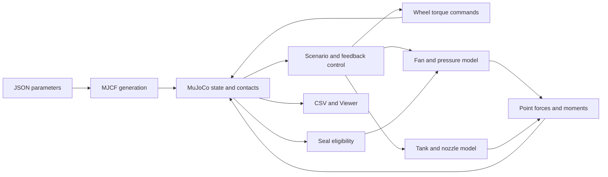

# Simulation model design (detailed)

For a diagram-led introduction, read the [summary](SIMULATION_DESIGN_SUMMARY.html) first. A [Japanese Markdown summary](SIMULATION_DESIGN_SUMMARY.ja.md) is also available.

This document describes the current implementation, rather than a proposed vehicle design. Read [Physics assumptions](PHYSICS.md) for parameter values and regression results, and [Control laws](CONTROL.md) for the controller. Inputs use SI units. The examples have not been calibrated against physical hardware.

## Components and responsibilities

| Source | Responsibility |
|---|---|
| [`model.py`](../suction_thrust_lab/model.py) | Generate the basic MJCF: collision shapes, visual shapes, free joint and estimated inertia |
| [`physics.py`](../suction_thrust_lab/physics.py) | Integrate fan speed, plenum pressure, battery energy and tank gas; return force magnitudes |
| [`simulation.py`](../suction_thrust_lab/simulation.py) | Validate core inputs, detect flat seals, transform/apply forces, step MuJoCo and export state |
| [`halfpipe.py`](../suction_thrust_lab/halfpipe.py) | Generate the curved course and driven wheels; add ray-based seals, changing mass, flight control and landing checks |
| [`full_size.py`](../suction_thrust_lab/full_size.py) | Generate the experimental full-size MJCF; reuse the half-pipe simulation and controller |
| [`__main__.py`](../suction_thrust_lab/__main__.py) | Select a scenario, run physics/Viewer and write CSV |
| [`record_halfpipe.py`](../scripts/record_halfpipe.py) | Render physical trajectories and append a slower replay; it does not drive the vehicle |



The custom models supply loads to MuJoCo. Contact resolution, friction, gravity and articulated rigid-body integration remain the engine's responsibility. The flight controller never overwrites the trajectory with its reference position or orientation.

Conceptually, at each step MuJoCo solves the generalized dynamics:

```text
M(q) v_dot + c(q,v) = torque_actuator + torque_custom
                    + torque_passive + J_contact(q).T lambda_contact
```

`c` includes gravity and velocity-dependent terms; `torque_custom` contains the point loads supplied by this project. The contact solver determines normal/friction reactions. This equation describes the per-step rigid-body model: changing tank mass is handled by the explicit model-constant update described below. Quaternion position coordinates and angular velocities have different representations, so the full `qpos` derivative is not simply the `qvel` array.


## State, frames and force application

The world frame has +z upward. Vehicle axes are +x forward, +y left and +z upward. Let `R` be `data.xmat[car].reshape(3, 3)`: it maps body-frame vectors into the world frame. `R[:, 2]` is the vehicle's upward axis in world coordinates.

| State | Representation |
|---|---|
| Vehicle position and orientation | First seven `qpos` entries: world position and quaternion `(w, x, y, z)` |
| Vehicle velocity | First six `qvel` entries: world linear velocity and body angular velocity |
| Driven wheel motion | Four additional hinge coordinates/velocities in half-pipe profiles |
| Fan state | Normalized speed, positive pressure difference, remaining battery energy |
| Tank state | Remaining gas mass; pressure derived from that mass |
| Scenario state | Stage, launch pose/time, recovery reference, contact history and failure text |

For a nozzle at body position `r_i`, with unit **vehicle-force** direction `d_i` and thrust magnitude `f_i`:

```text
application_point_world = body_position + R r_i
force_world             = R d_i f_i
moment_body             = r_i × (d_i f_i)
```

`Simulation.apply_force()` calls `mj_applyFT` with the world force and its application point; MuJoCo converts this into generalized force. The code does not add `r × F` a second time. Exhaust arrows point opposite `d_i` and have a display-only length scale. The moment shown above is about the chassis origin; separately modeled wheels can shift the assembled system's center of mass. MuJoCo handles the articulated response rather than applying that chassis-origin formula as an independent whole-vehicle torque.

The basic body has one free joint, a chassis box and four fixed wheel cylinders. Half-pipe models instead use four wheel bodies with hinge joints and torque motors. Motor reaction and tire contact can therefore affect the chassis; wheel spin without contact does not provide a fictitious propulsive force. Contact friction is configured in MJCF, rather than added as a separate hand-written tire force.

Visual shapes have zero mass and disabled collision. Replacing visual geometry does not automatically replace collision geometry or identify its inertia. The landing-pad marker and track-edge strips are also visual only; landing contact is with the actual floor.

## Geometry and inertia

`make_xml()` estimates a diagonal box inertia from configured mass `m` and dimensions `(l, w, h)`:

```text
Ixx = m (w² + h²) / 12
Iyy = m (l² + h²) / 12
Izz = m (l² + w²) / 12
```

The basic profiles use this fixed body mass/inertia throughout a run. Their tank gas is treated as already included in the configured mass; its subsequent loss does not update inertia.

For the miniature half-pipe, four 1 g wheels are assigned separate masses and the chassis dry mass is reduced by their sum. Its saved `dry_inertia` is the box inertia generated by the base model, an approximation rather than an exact recomputation of a measured chassis. The full-size generator explicitly calculates a box inertia for its chassis dry mass after subtracting the four wheel masses. The wheels also contribute their own inertia and joint armature.

At runtime, half-pipe profiles use:

```text
m_total        = m_configured_dry + m_gas
m_chassis      = m_configured_dry - 4 m_wheel + m_gas
I_chassis      = I_saved_dry * m_chassis / m_chassis_dry
```

Gas is assumed to remain symmetric around the chassis origin. `update_mass()` changes model constants and uses scratch `MjData` with `mj_setConst`; the real `qpos`/`qvel` are preserved. It then refreshes the real derived state. This is a lumped variable-mass approximation, not a simulation of gas moving inside a tank or of changing tank geometry.

The half-pipe is a semicircle in the world x–z plane. Its reference centerline is `(r sin(a), 0, r(1 - cos(a)))`, for `a` from 0 to π. There are 128 short, rotated collision boxes. Ray tests use these same boxes, so the seal surface and contact surface agree; neither is an infinitely smooth analytical circle.

## Flat and curved seal models

A positive plenum pressure difference creates attraction **only when a seal is eligible**. Both methods return `(surface_name, gap, direction_world)`. Invalid geometry returns no gap and zero direction.

The load direction matters. In a static horizontal-floor experiment, total normal load is approximately `mg + F_suction`. Under a ceiling, the ceiling's normal reaction is downward and equilibrium requires `F_suction = mg + N`; retention therefore needs more suction than weight to keep a positive contact load. For 0.120 kg and 0.01 m², the weight-only pressure threshold is 117.72 Pa. On a vertical wall, suction is normal to the wall: tire friction/drive must support the tangential weight. A rough static condition is `mu * N >= mg`, not just `F_suction >= mg`. Curved climbing also needs acceleration and normal-load balance; those reactions are resolved through actual contacts, not an imposed path constraint.

Suction is applied as a single force at the skirt center `[0, 0, bottom_z]`. Its normal direction need not be exactly collinear with that offset, so it can produce an attitude moment. There is no separately integrated pressure distribution or elastic skirt mesh.


### Basic floor, wall and ceiling

`Simulation.seal()` transforms the four skirt corners into world coordinates. Each candidate surface has a finite patch, a point and a normal pointing from the solid into free space. Every corner must be inside the patch. With the supplied defaults:

- Vehicle +z must align with the surface normal: dot product at least 0.995.
- Signed corner distances must range from at least −1 mm to at most `suction.max_gap` (2 mm).
- The leakage gap is the nonnegative mean corner distance, subsequently bounded below by `suction.min_gap`.
- The applied force points opposite the surface normal, toward the solid.

Thus a vehicle under the ceiling must be inverted to seal. The small permitted negative distance tolerates contact penetration; it is not a model of skirt material deformation.

### Half-pipe and full-size examples

`HalfpipeSimulation.seal()` casts five rays, at the four skirt corners and the center, along body −z. Each ray starts `0.01 * L` above its skirt point. The hit distance minus that offset is its local gap. `L` is the profile's length scale.

Only static course/floor geometry in render group 0 is eligible. Vehicle geometry and decorative strips/landing markers are excluded from the ray mask. All five hits must exist, their normals must have a dot product of at least 0.94 with body +z, and gaps must lie between `−0.004 * L` and `ramp.skirt_travel`. The resulting force points opposite the normalized mean hit normal.

The compliant skirt is an eligibility approximation: for an accepted set of hits, the returned gap is `max(0, max_gap_seen - skirt_travel)`, which is zero under those acceptance conditions. The fan therefore uses the residual `suction.min_gap` while the curved seal is valid. Increasing distance inside the allowed travel does **not** gradually increase leakage in this implementation. At the edge, loss of any required hit invalidates the seal. No remote ramp attraction is applied.

## Fan and pressure integration

`Suction.pressure` stores the positive difference `p = P_ambient - P_plenum`. It is not the absolute plenum pressure. For normalized speed `n`:

```text
p_shutoff(n) = p_max n²
Q_fan(p,n)  = Q_max n max(0, 1 - p / p_shutoff(n))
Q_leak(p,h) = Cd * 4(hx + hy) * h * sqrt(2p / rho)
F_suction   = p A_effective
```

Fan flow is zero when `n = 0`. The rectangular skirt perimeter is `4(hx + hy)`; perimeter times gap approximates the leakage area. The P–Q curve connects free-air flow and shutoff pressure; it cannot deliver both maxima simultaneously.

Fan speed has a first-order lag, integrated with its exact constant-command update:

```text
n_next = n + (clip(command,0,1) - n) * (1 - exp(-dt / tau_fan))
```

Electrical demand is `P_max n³`. Battery energy limits the interval's fan power, and speed is reduced if insufficient energy remains. Fan electrical use is an assumed input law; there is no calibrated efficiency map.

For a valid seal, the isothermal, small-pressure-difference approximation is:

```text
dp/dt = P_ambient / V_plenum * (Q_fan - Q_leak)
```

The implementation solves the backward-Euler residual with 40 bisection iterations, evaluating both flows at the new pressure. This avoids an unstable explicit update for a small plenum volume. A lost seal instead vents immediately: pressure and suction force become zero, while the spinning fan can still consume power and move free air. Venting is not integrated as a finite-time release transient.

A perfectly sealed, stopped fan retains pressure because no reverse fan flow is modeled. That is an assumed blocked-flow limit, not a prediction that an ordinary unvalved fan seals perfectly. Normal presets retain a nonzero leak.

## Tank, thrust and resource accounting

The shared tank uses constant gas temperature `T_g`, volume `V_g` and specific gas constant `R_g`:

```text
m_initial  = P_initial V_g / (R_g T_g)
P_tank     = m_gas R_g T_g / V_g
m_residual = P_ambient V_g / (R_g T_g)
rho_P      = clip((P_tank - P_ambient) / (P_initial - P_ambient), 0, 1)
f_i        = f_i,max * clip(command_i,0,1) * rho_P
m_requested = dt * sum(f_i) / v_exhaust
```

Here `rho_P` is a dimensionless pressure factor, not air density. If demand exceeds usable gas, all nozzle thrusts are reduced by the same factor for that interval. The tank never consumes the residual mass corresponding to ambient pressure. Actual used mass updates the pressure, gas-use log and `E_exhaust += 0.5 * m_used * v_exhaust²`. No separate pressure-thrust term is used.

This model records exhaust kinetic energy, not a complete thermodynamic balance or compressor charging cost. Constant-temperature blow-down and constant exhaust velocity are effective approximations. In particular, the 70 MPa full-size profile needs real-gas, thermal, nozzle-flow and hardware-budget validation before practical interpretation.

Half-pipe wheel electricity uses positive mechanical motor power divided by 0.65 plus a quadratic torque-loss estimate. This is debited from the **same battery** after fan consumption; regenerative energy is not credited. The last interval's motor work is not rescaled to exactly match a small remaining battery balance, and the airborne wheel-braking command is still applied when that balance is zero. Treat these as approximate bookkeeping, not a fully coupled motor/electrical model.

## One simulation interval

For a half-pipe CLI/Viewer run, `advance()` performs the following sequence:

1. Read the physical state; update the scenario/reference and, when due, allocate a new nozzle command.
2. Set wheel torque commands, including airborne wheel braking.
3. Clear custom generalized forces and detect the current seal.
4. Advance fan/plenum/battery and tank states; apply suction and individual nozzle forces.
5. Call `mj_step`, then `mj_forward` to refresh pose/contact-derived values.
6. Account for wheel energy; update chassis mass/inertia if thrust consumed gas.
7. Detect new floor contacts, save touchdown speed and record failure conditions.
8. Export a row or render the refreshed state.

MuJoCo uses `implicitfast` with a 1 ms step. The flight command is held between controller updates; tank pressure and applied thrust still update every physics step. The basic demos call `Simulation.step()` directly with time-scheduled inputs and do not use the flight controller.

CSV pose/contact fields describe the refreshed state, while fan/thrust/seal fields describe the interval just integrated. `contacts` counts all contacts in the scene. `normal_load_N` sums normal magnitudes for contacts involving the vehicle subtree; it is not necessarily a world-z support force. See [Control laws](CONTROL.md) for allocation residuals and landing criteria.

## Scope of validation

The existing [physics tests](../tests/test_physics.py) compare pressure-area force, flow balance, thrust/gravity, torque and resource depletion. [Miniature](../tests/test_halfpipe.py) and [full-size](../tests/test_full_size.py) sequence tests check the physical trajectory, layout constraints and stable landing. These establish regression behavior under assumed parameters; they do not validate real fan hardware, a pressure vessel, tire construction or a production vehicle.
