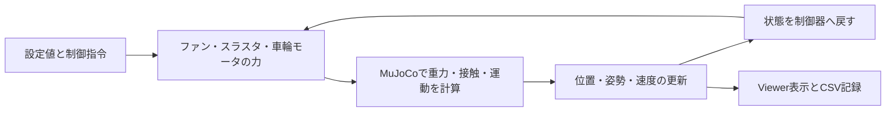
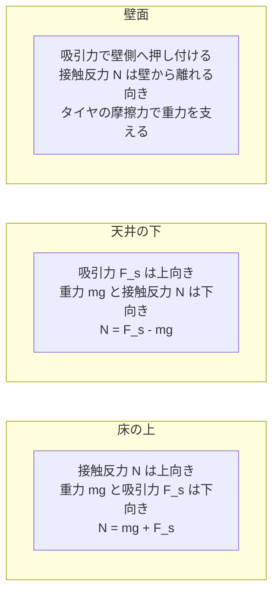
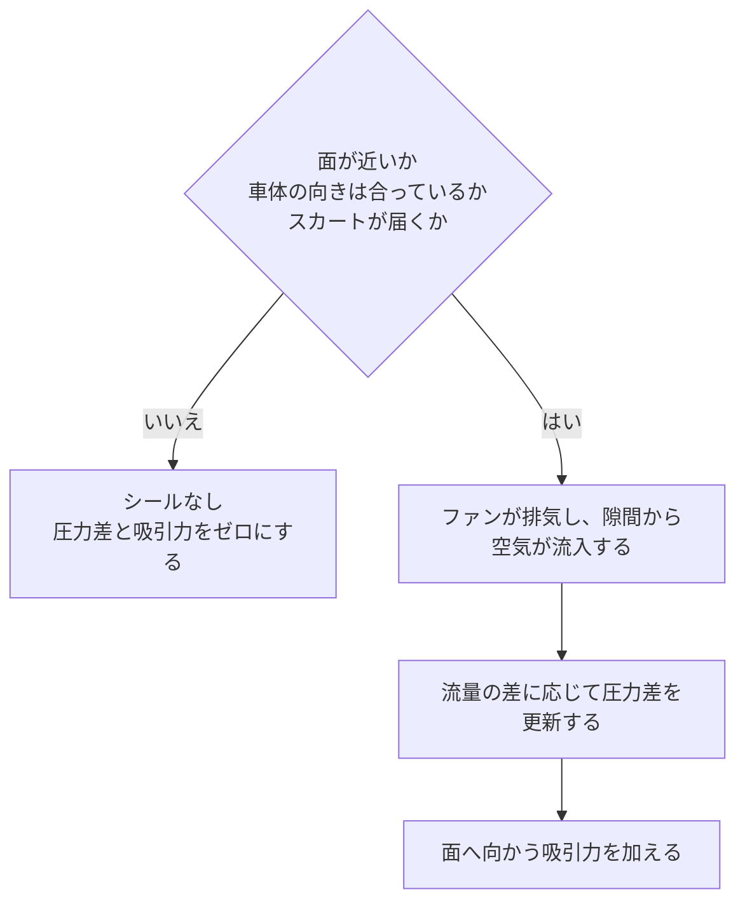

# シミュレーションモデルの設計 サマリー

車両に力を加え、その結果として位置と姿勢が変わる過程を計算します。ファンの吸引でタイヤを路面に押し付け、車輪で走り、ガススラスタで加速・回転するモデルです。

[英語のサマリー](SIMULATION_DESIGN_SUMMARY.html)に対応した日本語版です。数値計算法とコードの構成は、英語の[モデル設計 詳細版](SIMULATION_DESIGN.md)で説明しています。図も含めた1つのMarkdownファイルです。

## 1. 何を計算しているか



Python側では、負圧やガス消費量、加える力を計算します。MuJoCoはそれらの力と接触条件から、次の時刻の車両状態を求める役割です。制御器に目標位置を渡しても、車体をその座標へ直接移動させることはありません。

基本デモでは、自由に動く車体に車輪の形状を固定しています。ハーフパイプ版では、独立して回転・駆動する4つの車輪を使います。装飾用の車体形状やコース端の帯、着地点のマーカーから力は加わりません。

## 2. 吸引はタイヤを近くの面へ押し付ける



図は静止時の力の釣り合いを示しています。Nは面から車両への接触反力、mgは重力、F_sは吸引力です。力の大きさや車体の形状を縮尺どおりに描いたものではありません。

ファンがスカート内の空気を排出すると、車体下面の圧力が外気より低くなります。この圧力差によって車両が面へ引かれます。

```text
吸引力 = 圧力差 × 有効吸着面積
```

| 面 | 吸引の働きと保持条件 |
|---|---|
| 床 | 重力に加えて車体を押し付け、タイヤの垂直荷重を増やす |
| 天井 | 上向きに引き付ける。接触反力を正に保つには、吸引力が重量を上回る必要がある |
| 壁 | タイヤを壁へ押し付ける。壁に沿う重力は、摩擦力や車輪駆動で支える必要がある |

壁面で静止するとき、上向きの摩擦力F_tは重力mgと同じ大きさです。摩擦係数をμとするとF_t ≤ μNなので、吸引力だけでなく摩擦条件も満たす必要があります。

基本モデルの質量120 g、有効吸着面積0.01 m²では、約118 Paの圧力差で重量と同じ大きさの吸引力になります。これは力の計算を確かめる値であり、登坂や天井保持の設計条件をすべて満たす値ではありません。

壁面の図は力の説明用です。現在の平らな天井のデモでは、天井直下で反転した初期状態から吸着・離脱を確認します。汎用的な壁面走行や天井走行は今後の実装対象です。

## 3. 面をシールできるときだけ吸引力を加える



隙間が大きいほど空気が流入しやすくなります。一方、ファンの排気流量は圧力差が大きいほど減ります。最大流量と最大圧力を同時には出せません。モデルには、この圧力と流量の関係、ファンの応答遅れ、有限のバッテリー残量を含めています。

平らな面で確認するのは、スカートの四隅です。曲面では四隅と中央からレイを飛ばし、必要な点が面を検出できなくなるとシールを無効にします。遠くの壁や天井に吸引力が働くことはありません。

曲面版では、スカートが届く範囲なら残留漏れを一定とする近似を使います。スカートの変形に応じて、漏れが連続的に変わるモデルではありません。

## 4. スラスタは有限のガスで加速と回転を生む

```text
推力 = ガスの質量流量 × 有効排気速度
```

スラスタは排気と逆向きに車両を押します。車体中心から離れた位置に力を加えると、回転モーメントも生じます。噴射位置に加えた力から車体の運動を求めるのは、MuJoCoの役割です。

全スラスタで有限のタンクを共有します。ガスを使うと圧力と利用可能な推力が下がり、使えるガスがなくなると推力も失われます。ハーフパイプ版では、消費に合わせて車体質量と慣性モーメントも減らします。基本デモは簡略化のため質量を固定しています。

バッテリー消費、ガス消費、排気の運動エネルギーを記録します。資源消費の目安には使えますが、電気系や熱力学を完全に再現した計算ではありません。

## 5. 結果をどう読むか

| 実装上の近似 | このモデルだけでは確かめられないこと |
|---|---|
| プリミティブ形状による接触判定と推定した慣性モーメント | 実際に製造した車両の正確な運動 |
| 集中定数の圧力・漏れ・ファン特性 | 実際のスカート周辺の詳しい流れ |
| 等温の理想気体と一定の有効排気速度 | 高圧タンクやノズルの実際の性能 |
| 接触・摩擦と駆動輪 | 実測に基づくタイヤやサスペンションの挙動 |
| 小型版と実車サイズ版の設定 | スケールだけを変えた比較や、実車としての実現可能性 |

実車サイズ版では、機器の能力と制御設定を別途仮定しています。特に高圧タンクについては、実在気体の性質や温度変化を考慮した検証が必要です。デモの完走は、仮定した条件のもとで計算上の運動が成立したことを示します。

次に読む文書は、[制御則サマリー](CONTROL_SUMMARY.ja.md)、[モデル設計 詳細版・英語](SIMULATION_DESIGN.md)、[仮定と基準値・英語](PHYSICS.md)です。
